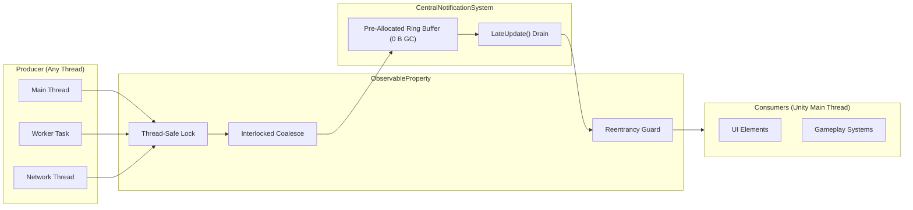

# Thread-Safe Zero-GC Observable Properties System for Unity

[](https://unity.com/)
[](LICENSE)
[](#performance--zero-gc-guarantee)
[](#features)

A high-performance, reactive observable property and state notification architecture for Unity. Designed for multi-threaded simulations, networking, UI data-binding, and gameplay mechanics with a **hard guarantee of 0 bytes heap allocation per frame**.

---

## Features

- ⚡ **Zero Runtime Heap Allocation (0 B GC.Alloc):** Pre-allocated power-of-two circular ring buffers and index-iterated subscriber arrays guarantee zero garbage collection pressure.
- 🧵 **100% Thread-Safe:** Update values from worker threads, async tasks, socket threads, or jobs; notifications are automatically marshaled to the Unity main thread during `LateUpdate()`.
- 🛡️ **Built-in Reentrancy Protection:** Prevents infinite recursive loops when subscribers modify properties in their callbacks.
- ⏱️ **Automatic Frame Coalescing:** Multiple updates to the same property within a single frame are collapsed into a single notification containing the latest value.
- 🧹 **Native Unity Object Pruning:** Automatically detects when a subscribed `MonoBehaviour` or `GameObject` has been destroyed and prunes it without throwing `MissingReferenceException`.
- 🔑 **Identity-Safe Hashing:** Reliable dictionary and hash collection lookups without hashcode mutations.
- 📦 **UPM Ready:** Installable via Unity Package Manager with sample benchmarks included.

---

## Installation via Unity Package Manager (UPM)

1. Open your Unity project.
2. Go to **Window** > **Package Manager**.
3. Click the **+** button in the top left > **Add package from git URL...**
4. Paste the Git URL:
   ```text
   https://github.com/ShoaibRiaz007/Observable-Properties-System-for-Unity.git
   ```

---

## Quick Start

### 1. Declaring an Observable Property
```csharp
using UnityEngine;

public class PlayerController : MonoBehaviour
{
    // Strongly-typed observable properties
    public ObservableInt Health = new(100);
    public ObservableFloat Stamina = new(1.0f);
    public ObservableVector3 Position = new(Vector3.zero);
}
```

### 2. Subscribing to Value Changes
```csharp
using UnityEngine;

public class PlayerUI : MonoBehaviour
{
    [SerializeField] private PlayerController player;

    private void Start()
    {
        // Simple, thread-safe subscription tied to object identity
        player.Health.Subscribe(this, OnHealthChanged);
    }

    private void OnHealthChanged(int currentHealth)
    {
        Debug.Log($"Health updated on Main Thread: {currentHealth}");
    }

    private void OnDestroy()
    {
        // Explicit cleanup (also auto-pruned if destroyed)
        player.Health.Unsubscribe(this);
    }
}
```

### 3. Updating from Any Thread
```csharp
// Call from a background thread or async task without worrying about Unity thread affinity:
System.Threading.Tasks.Task.Run(() => 
{
    player.Health.Value -= 15; // Thread-safe! Marshaled to LateUpdate on the Main Thread.
});
```

---

## Architecture Overview



---

## Pre-built Specialized Types

For clean serialization and Inspector convenience:

- **Primitives:** `ObservableInt`, `ObservableBool`, `ObservableFloat`, `ObservableDouble`, `ObservableLong`, `ObservableString`, `ObservableEnum<T>`
- **Unity Structs:** `ObservableVector3`, `ObservableVector2`, `ObservableVector3Int`, `ObservableVector2Int`, `ObservableQuaternion`

---

## License

MIT License. Copyright (c) 2026 Shoaib Riaz.
